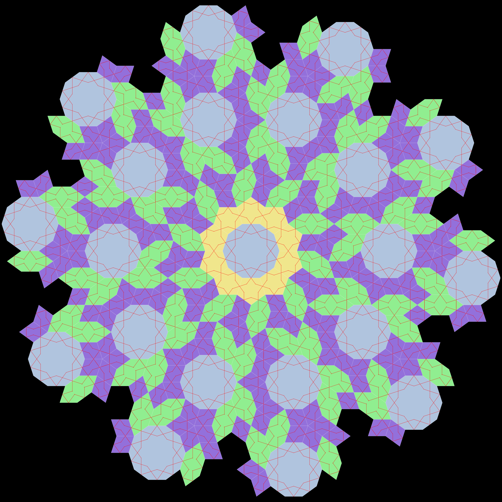

# Girih Tile Generator

**Procedural girih tilings from the five fundamental girih modules, exported as fabrication-ready DXF, SVG and PNG.**



Girih is the strapwork tradition of Islamic geometric art, documented in sources such as Panel 28 of the Topkapı Scroll. Its patterns are built from five equilateral tiles whose angles are all multiples of 36°, so every tile edge points in one of only ten directions. This is the source of the five- and tenfold order characteristic of decagonal, quasicrystal-like girih designs.

This project grows girih tilings tile by tile, verifying every placement, then draws the decorative strapwork lines across them and exports the result at real physical dimensions, ready for laser cutting, CNC engraving or CAD.

Developed for the **TÜBİTAK 2204-A High School Research Competition** (1st place regional, 3rd place national), and the basis of the preprint described [below](#paper).

---

## The five girih modules

All tiles share a common edge length, and every interior angle is a multiple of 36°.

| Module | Interior angles | In 36° units |
|---|---|---|
| Decagon | 144° × 10 | `4 4 4 4 4 4 4 4 4 4` |
| Elongated hexagon | 72°, 144°, 144°, 72°, 144°, 144° | `2 4 4 2 4 4` |
| Bowtie | 72°, 72°, 216°, 72°, 72°, 216° | `2 2 6 2 2 6` |
| Rhombus | 72°, 108°, 72°, 108° | `2 3 2 3` |
| Pentagon | 108° × 5 | `3 3 3 3 3` |

Because 360° / 36° = 10, the full angle around any vertex splits into **10 angular sectors**, and every tile corner fills a whole number of them. That turns the question "does this tile fit here?" into a simple check on a 10-slot sector mask, which is the core idea of the method.

---

## How it works

1. **Seed.** A decagon is placed at the centre of the canvas.
2. **Frontier.** Every vertex whose sector mask is neither empty nor full goes into a queue of open points.
3. **Fill.** For each open point inside the canvas, the generator tries to place tiles into its empty sectors, with several retries per point.
4. **Placement tests.** A candidate tile is accepted only if every one of its corners passes:
   - **Angular compatibility:** its sector mask doesn't overlap the sectors already filled at that vertex, and it never leaves a single 36° gap, since no girih tile has a 36° corner to fill it.
   - **Epsilon (ε) proximity:** a new corner that lands within ε × side length (ε = 0.1) of an existing vertex is merged into it, so floating-point drift doesn't create near-duplicate points.
   - **Spacing:** no new vertex lands closer than (1 − ε) × side length to any existing vertex. This heuristic prevents overlapping tiles in practice (no overlaps were found in our tests), although it is not an exact intersection test.
5. **Merge.** Accepted masks are added into the vertex masks, and the tile's new vertices join the queue. A rejected tile is rolled back cleanly.
6. **Stop.** Generation ends when the queue empties or the iteration limit is reached.
7. **Strapwork.** From the midpoint of every tile edge, two strap lines are drawn inward at fixed angles and lengths per module, producing the interlaced girih star pattern.

Optional **C5 / C10 rotational symmetry** places each tile together with its rotated copies around the canvas centre, giving fivefold or tenfold medallion-style designs.

---

## Getting started

**Requirements:** Python 3 and the packages in `v2/requirements.txt` (matplotlib, ezdxf, shapely, numpy). The experimental photo reconstruction additionally needs opencv-python and scipy.

```bash
git clone https://github.com/Paksu64/Girih-Tile-Generator.git
cd Girih-Tile-Generator/v2
pip install -r requirements.txt
```

### Generate a design

```bash
# 600 × 400 mm panel with 25 mm tile edges
python main.py --width 600mm --height 400mm --side 25mm

# Tenfold rotational symmetry
python main.py --width 600mm --height 600mm --side 25mm --symmetry c10

# Load an existing design and keep growing it
python main.py --load strapwork_001 --continue --iterations 300
```

| Option | Default | Description |
|---|---|---|
| `--width`, `--height` | – | Canvas size in mm (required for new designs) |
